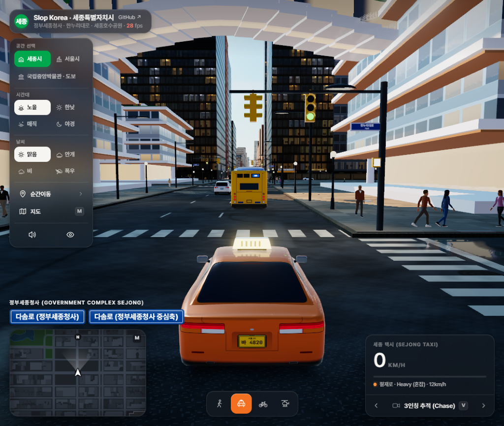
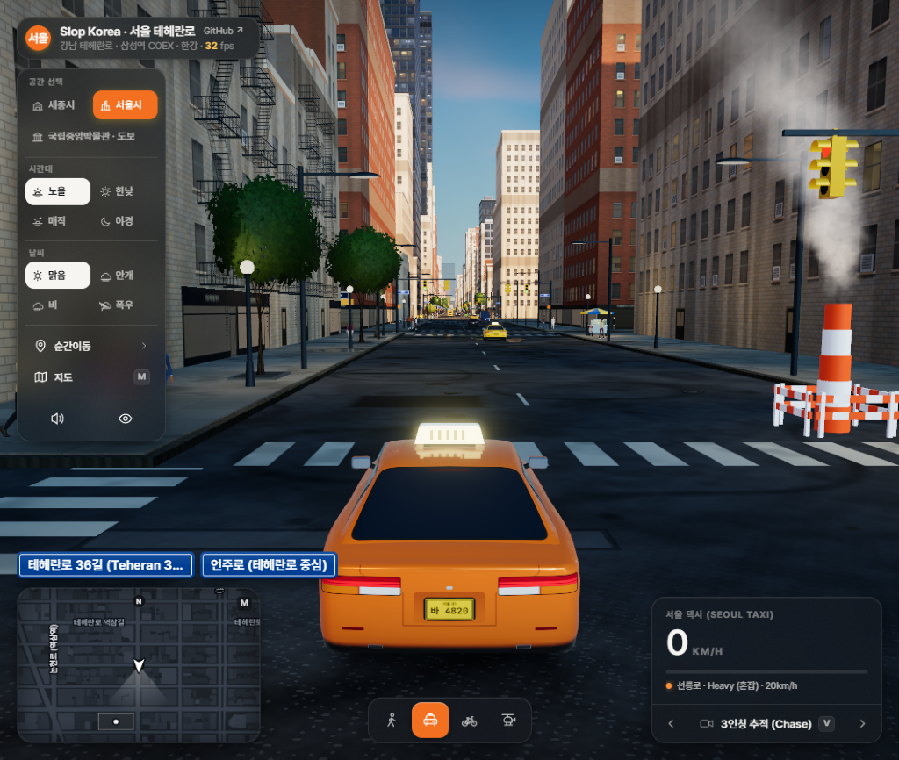
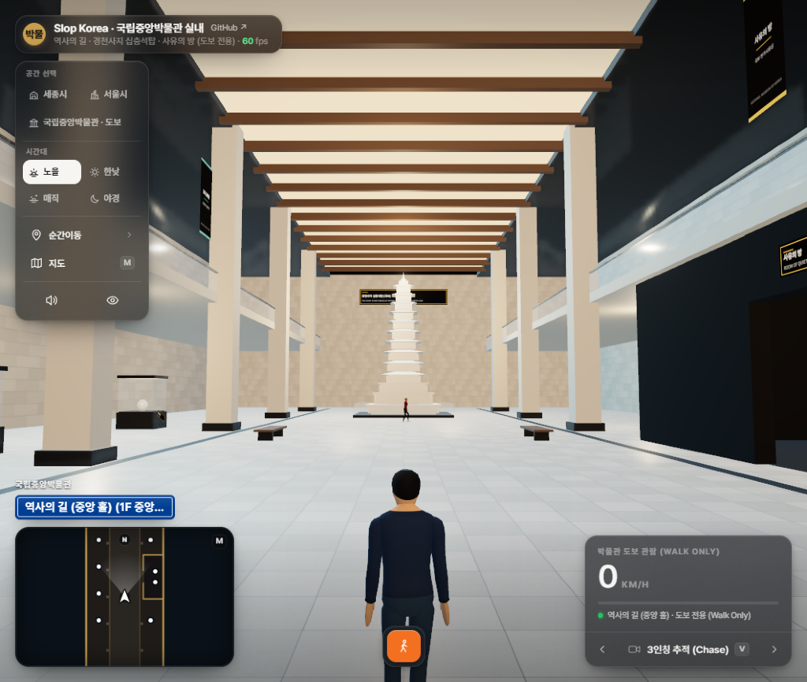
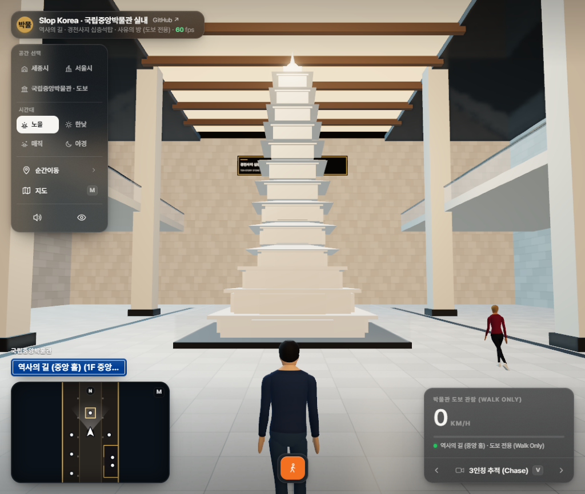
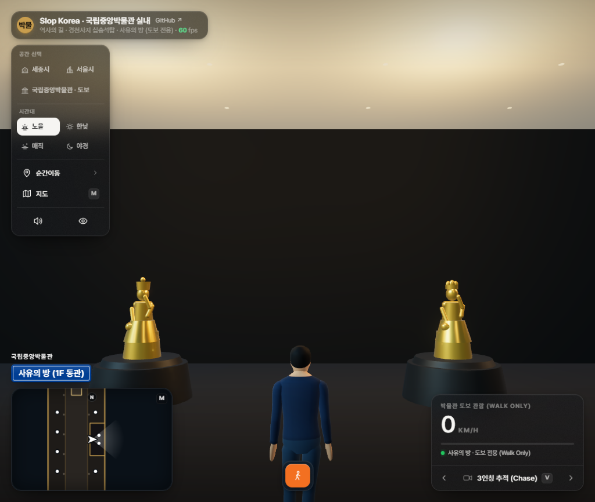

# Slop Korea · 세종특별자치시 · 서울 테헤란로 · 국립중앙박물관 실내

<p align="center">
  <a href="README.md"><strong>English / Bilingual README</strong></a> &nbsp;|&nbsp;
  <strong>한국어 (Korean)</strong>
</p>

> **[Three.js](https://threejs.org/) WebGPURenderer + TSL(Three Shading Language)**(WebGL2 자동 폴백 지원) 기반으로 구현한 3D 실시간 인터랙티브 시뮬레이션입니다.
> **세종특별자치시(정부세종청사)**, **서울 테헤란로**, 그리고 **도보 관람 전용 국립중앙박물관 실내**를 웹 브라우저에서 자유롭게 탐험할 수 있습니다.

---

## 📸 주요 화면 캡처 (5 Key Screenshots)

### 1. 세종특별자치시 · 정부세종청사 (Sejong City · Government Complex Sejong)
정부세종청사의 연속 옥상정원 건축물, 공중 연결브릿지, 시간대별 자동 조명 전환 시스템, 좌측 LNB 및 실시간 교통량 표시 화면입니다.



### 2. 서울특별시 · 테헤란로 (Seoul · Teheran-ro & Gangnam)
강남 테헤란로 마천루 숲, 한국 도로명 표지판, 1층 실사 상가 텍스처, 서울 대중교통 및 구간별 교통 혼잡도 실시간 순환 화면입니다.



### 3. 국립중앙박물관 실내 · 역사의 길 (도보 전용 / Walk-Only)
화강암 바닥, 석회암 벽체, 웅장한 열주와 목재 천창 루버, 국보 유물 진열장이 배치된 **역사의 길**을 오직 **도보 관람(Walk Only)** 방식으로 걷는 화면입니다.



### 4. 국립중앙박물관 실내 · 경천사지 십층석탑 광장 (Ten-Story Stone Pagoda of Gyeongcheonsa)
박물관 중앙 축의 핵심 상징물인 13.5m 규모의 다층 대리석 **경천사지 십층석탑**과 보호 유리 난간, 건축 스포트라이트 연출 화면입니다.



### 5. 국립중앙박물관 실내 · 사유의 방 (Room of Quiet Contemplation)
별빛 핀조명이 비추는 어두운 명상 공간 속에서 국보 제78호·제83호 **금동미륵보살반가사유상** 2점을 감상하는 화면입니다.



---

## ✨ 구현 특징

### 1. 3개 공간 완전 분리 및 좌측 LNB 전환
좌측 세로형 **LNB(Left Navigation Bar)** 또는 전체 지도(`[M]`)에서 각 공간을 독립적으로 선택할 수 있습니다.

* **세종특별자치시 (`세종시`)**
  * **정부세종청사 특화 건축 및 자동 조명 시스템**: 다동 청사·연속 옥상정원·공중 연결브릿지 구현, 주간 자연광 반사와 야간 사무실 조명 자동 전환.
  * **주요 랜드마크**: 국립세종도서관(펼쳐진 책 형태 지붕), 대통령기록관, 국무총리실, 세종특별자치시청(원형 아크 청사), 세종호수공원.
  * **관공서 도로망**: 한누리대로(BRT), 다솜로, 절재로, 도움3·6·8로, 갈매로, 시청대로.
* **서울특별시 테헤란로 (`서울시`)**
  * **강남 도로망**: 테헤란로, 강남대로, 논현로, 언주로, 선릉로, 삼성로, 영동대로.
  * **주요 랜드마크**: 강남파이낸스센터(GFC), 한국종합무역센터, 코엑스 & K-POP 스퀘어, 파르나스타워, GT타워, 포스코센터, 선정릉.
  * **실사 거리 디테일**: 한국 도로명 표지판, 지하철 2호선 출입구 폴사인, 실사 상가 텍스처(스타벅스, 올리브영, 파리바게뜨, 투썸플레이스, GS25), 서울 택시·따릉이·시내버스.
* **국립중앙박물관 실내 (`국립박물관 · 도보 전용`)**
  * **도보 전용(Walk-Only) 강제 정책**: 박물관 내부에서는 `도보(person)` 모드만 허용되며, 차량·자전거·헬기 버튼 숨김/비활성화 및 단축키(`2`/`3`/`4`)·경적(`B`)·게임패드 모드 전환을 모두 차단합니다.
  * **전시 공간 및 국보 유물**:
    * **으뜸홀 · 중앙 로비**, **역사의 길**, **경천사지 십층석탑 광장**, **사유의 방**
    * 경천사지 십층석탑, 금동미륵보살반가사유상(국보 78호·83호), 황남대총 신라 금관, 백제 금동대향로, 고려 청자 상감운학문 매병, 조선 백자 달항아리, 금동여래입상, 청화백자 항아리
  * **실내 관람 전용 시스템**: 실내 관람객 보행 AI, 벽면/기둥/진열장 AABB 충돌 처리, 실내 카메라 천장·벽면 클램핑, 실내 텔레포트 5곳, 실내 카메라 뷰 3종, 미니맵·전체 지도 전용 평면도 렌더링.

### 2. 실시간 구간별 교통 혼잡도 순환 & TSL 보행자 애니메이션
* **실시간 교통 혼잡도 순환**: 세종·서울 도로 구간이 **Congested(정체)**, **Heavy(서행)**, **Normal(보통)**, **Smooth(원활)** 상태를 동적으로 순환하며 상단 HUD 라벨·속도·색상 도트에 실시간 반영됩니다.
* **TSL 버텍스 셰이더 보행 애니메이션**: 보행자가 GPU 셰이더 기반 걷기 사이클로 지정 경로를 자연스럽게 이동합니다.

### 3. 시간대별 분위기 & TSL 동적 날씨 시스템
* **4대 시간대**: 노을(Sunset), 한낮(Midday), 매직아워(Twilight), 야경(Night) — 실외 스카이·빌딩 조명, 정부세종청사 자동 조명, 박물관 실내 천창·스포트라이트 강도를 연동 제어합니다.
* **4대 날씨(실외 전용)**: 맑음(Clear), 안개(Fog), 비(Light Rain), 폭우(Downpour) — TSL 빗줄기 파티클, 젖은 도로 반사(SSR), 화면 렌즈 물방울 셰이더 제공 (박물관 실내 진입 시 자동 해제).

---

## 🎮 조작 안내

| 키 | 기능 |
|:---|:-----|
| `W` `A` `S` `D` / 방향키 | 걷기 / 주행 / 조향 |
| `Space` | 점프 (도보) / 상승 (헬기) |
| `1` `2` `3` `4` | 이동 수단 전환: 도보 / 택시 / 공공자전거 / 헬기 *(박물관 실내는 `1` 도보 전용)* |
| `V` / `C` | 카메라 시점 전환 (3인칭 추적, 액션, 1인칭, 명소 뷰) |
| `M` | 전체 지도 / 박물관 실내 평면도 열기·닫기 |
| `드래그` / `스크롤` | 시점 회전 / 줌 |
| `B` | 경적 (실외 택시 전용) |
| `N` | 사운드 켜기·끄기 |
| `H` | HUD 표시 토글 |

---

## 🛠️ 기술 스택 및 로컬 실행

* **Rendering**: Three.js (`r187`) `WebGPURenderer` + `TSL` (`WebGL2Backend` 폴백)
* **Backend & Build**: Node.js (v20+), Express, Vite, TypeScript, Tailwind CSS
* **Test**: Node.js 내장 `node:test` 단위 테스트 스위트

```bash
# 의존성 설치
npm install

# 개발 서버 실행 (http://localhost:3000)
npm run dev

# 프로덕션 빌드
npm run build

# 단위 테스트 실행
npm test
```

---

## 📜 크레딧 및 라이선스
* 본 프로젝트는 Ricardo Cabello([@mrdoob](https://github.com/mrdoob))의 [slop-newyork](https://github.com/mrdoob/slop-newyork)을 기반으로 확장·재구성되었습니다. ([MIT License](LICENSE))
