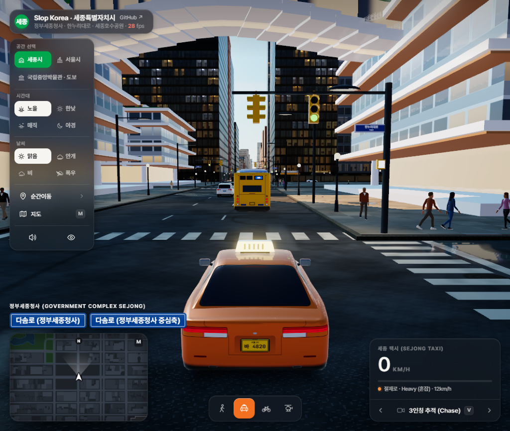
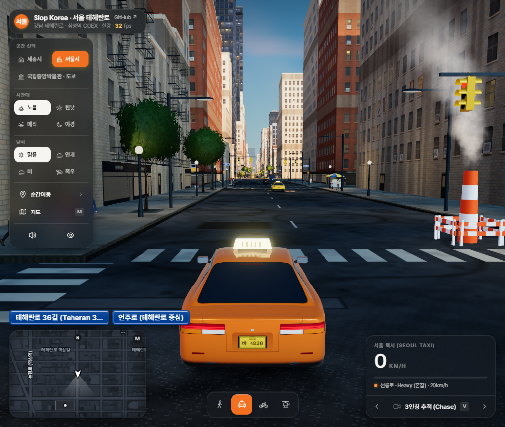
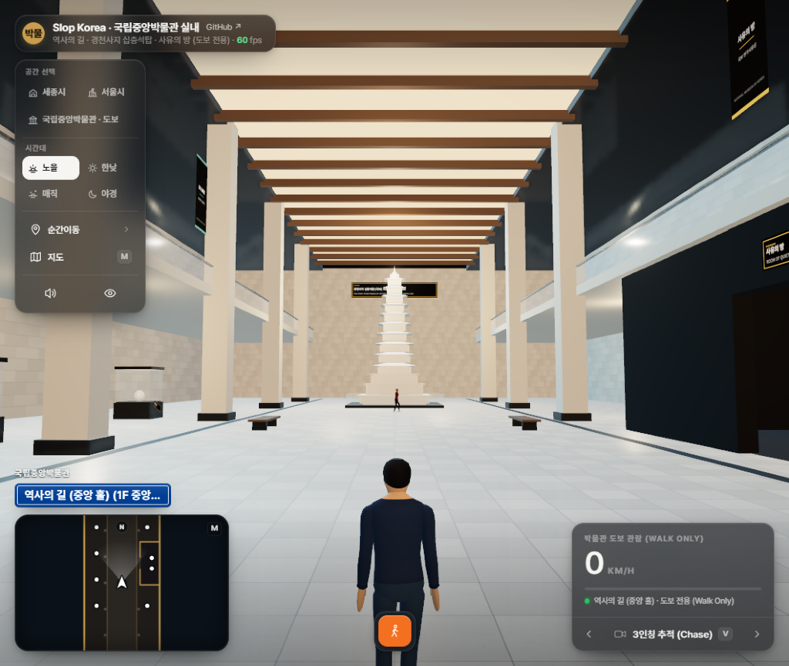
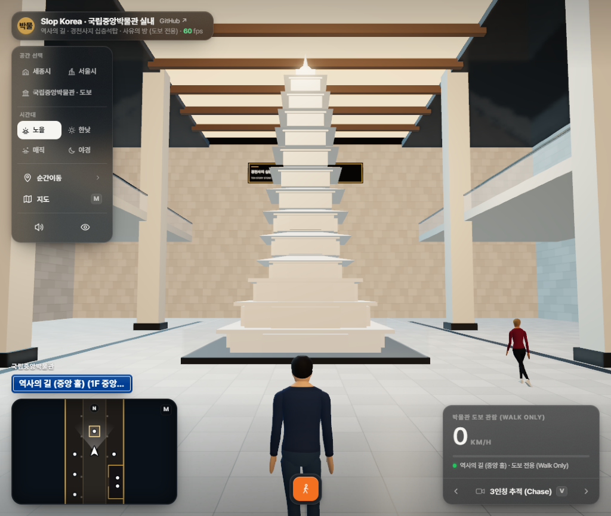
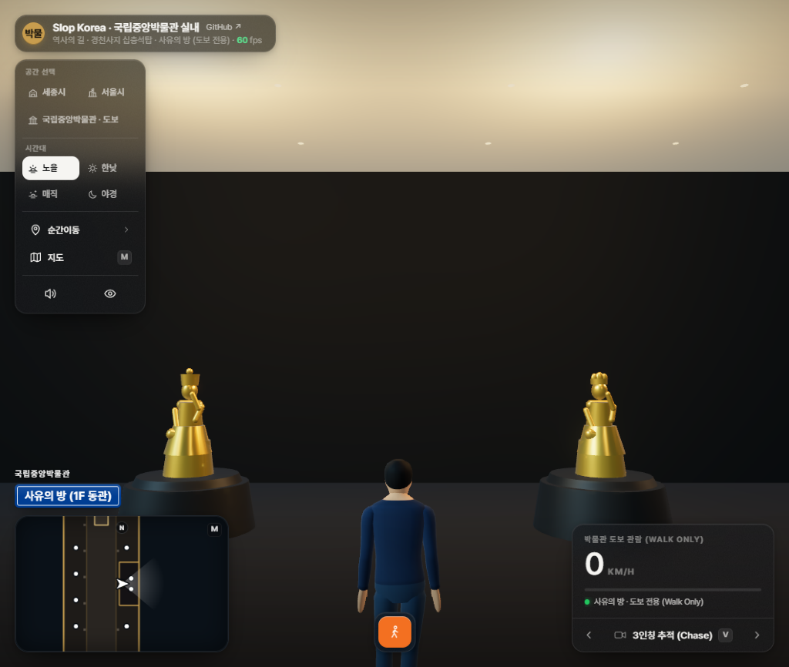

# Slop Korea · Sejong City, Seoul Teheran-ro & National Museum of Korea

<p align="center">
  <a href="#english"><strong>English</strong></a> &nbsp;|&nbsp;
  <a href="#한국어"><strong>한국어 (Korean)</strong></a> &nbsp;|&nbsp;
  <a href="README.ko.md"><strong>한국어 단독 문서 (README.ko.md)</strong></a>
</p>

> Interactive 3D real-time web simulation built on **Three.js WebGPURenderer + TSL (Three Shading Language)** (with automatic WebGL2 fallback), featuring three distinct Korean environments: **Sejong Administrative City**, **Seoul Teheran-ro**, and a **Walk-Only Interior of the National Museum of Korea**.
>
> **Three.js WebGPURenderer + TSL** 기반으로 구현된 3D 실시간 인터랙티브 시뮬레이션입니다. **세종특별자치시(정부세종청사)**, **서울 테헤란로**, 그리고 **도보 관람 전용 국립중앙박물관 실내**를 하나의 웹 애플리케이션에서 자유롭게 탐험할 수 있습니다.

---

## 📸 Key Screenshots / 주요 화면 캡처

| # | English Description | 한글 설명 |
|:-:|:--------------------|:---------|
| 1 | **Sejong City · Government Complex Sejong** — Continuous rooftop-garden ministry complex, elevated skybridges, automated day/night office lighting, LNB switcher, and live traffic segment gauge | **세종특별자치시 · 정부세종청사** — 연이어진 옥상정원 청사 건축물, 공중 연결브릿지, 시간대별 자동 조명 제어, 좌측 LNB 및 실시간 교통량 표시 |
| 2 | **Seoul · Teheran-ro & Gangnam** — High-density skyline, Korean street signs, storefronts, Seoul transit vehicles, and dynamic road-segment congestion cycling | **서울특별시 · 테헤란로** — 강남 마천루 스카이라인, 한국 도로명 표지판, 상가 디테일, 서울 대중교통 및 구간별 교통 혼잡도 실시간 순환 |
| 3 | **National Museum of Korea · Path of History (Walk-Only)** — Monumental granite & limestone atrium, colonnade, timber skylight louvers, display vitrines, and strictly enforced walk-only mode | **국립중앙박물관 · 역사의 길 (도보 전용)** — 화강암·석회암 대홀, 열주, 천창 루버, 국보 유물 진열장 및 차량/자전거/헬기가 차단된 실내 도보 전용 모드 |
| 4 | **National Museum of Korea · Ten-Story Stone Pagoda of Gyeongcheonsa** — 13.5m multi-tier marble National Treasure centerpiece with architectural wash lighting | **국립중앙박물관 · 경천사지 십층석탑** — 13.5m 규모의 다층 대리석 석탑 조형물과 따뜻한 실내 건축 조명 연출 |
| 5 | **National Museum of Korea · Room of Quiet Contemplation** — Darkened sanctuary chamber with starry pin-light ceiling and twin National Treasure Gilt-Bronze Pensive Bodhisattvas (NT 78 & 83) | **국립중앙박물관 · 사유의 방** — 어두운 명상 공간, 천장 별빛 핀조명, 국보 제78호·제83호 금동미륵보살반가사유상 쌍둥이 전시 연출 |

### 1. Sejong City · Government Complex Sejong (`세종특별자치시 · 정부세종청사`)


### 2. Seoul · Teheran-ro & Gangnam (`서울특별시 · 테헤란로`)


### 3. National Museum of Korea · Path of History — Walk-Only (`국립중앙박물관 · 역사의 길 도보 전용`)


### 4. National Museum of Korea · Ten-Story Stone Pagoda of Gyeongcheonsa (`국립중앙박물관 · 경천사지 십층석탑`)


### 5. National Museum of Korea · Room of Quiet Contemplation (`국립중앙박물관 · 사유의 방`)


---

<a id="english"></a>
# 🇬🇧 English Documentation

## ✨ Core Features

### 1. Three Isolated Interactive Environments (LNB Switcher)
Switch seamlessly from the vertical **Left Navigation Bar (LNB)** or Full Map (`[M]`) between three completely separated environments with dedicated landmarks, camera presets, teleports, and maps:
* **Sejong City (`세종시`)**:
  * **Government Complex Sejong (`정부세종청사`)** with multi-wing horizontal terraced architecture, rooftop garden geometry, elevated pedestrian skybridges, and an **automated day/night lighting system** that switches between natural daylight facade reflection and warm evening/night office illumination.
  * Iconic Sejong civic landmarks: **National Library of Sejong** (open-book curved roof), **Presidential Archives**, **Prime Minister's Office**, **Sejong City Hall** (circular civic arc), and **Sejong Lake Park**.
  * Administrative road network: **Hannuri-daero (BRT)**, **Dasom-ro**, **Jeoljae-ro**, **Doum 3/6/8-ro**, **Galmae-ro**, and **Sicheong-daero**.
* **Seoul Teheran-ro (`서울시`)**:
  * Gangnam financial & tech corridor: **Teheran-ro**, **Gangnam-daero**, **Nonhyeon-ro**, **Eonju-ro**, **Seolleung-ro**, **Samseong-ro**, and **Yeongdong-daero**.
  * Landmarks: **GFC (Gangnam Finance Center)**, **Trade Tower**, **COEX & K-POP Square**, **Parnas Tower**, **GT Tower**, **POSCO Center**, and **Seonjeongneung**.
  * Real Korean road signs, **Seoul Subway Line 2** entrances, high-resolution photographic storefront textures (Starbucks, Olive Young, Paris Baguette, A Twosome Place, GS25), and Seoul buses/taxis/Ddareungi.
* **National Museum of Korea Interior (`국립중앙박물관 실내` · Walk-Only)**:
  * **Strict Walk-Only Enforcement**: Vehicles (`Car`, `Bicycle`, `Helicopter`) are locked out at both the controller and UI layers—disallowed buttons are hidden/disabled, hotkeys `2`/`3`/`4` and horn `B` are blocked, and outdoor traffic/weather are completely hidden indoors.
  * **Architectural Zones**: Great Hall & South Lobby (`으뜸홀`), Path of History (`역사의 길`) with granite floor tiles, limestone ashlar walls, colonnade, mezzanine glass balconies, and timber skylight louvers, Ten-Story Stone Pagoda Atrium (`경천사지 십층석탑 광장`), and the darkened **Room of Quiet Contemplation (`사유의 방`)**.
  * **National Treasure Exhibits**: Ten-Story Stone Pagoda of Gyeongcheonsa, Twin Gilt-Bronze Pensive Bodhisattvas (NT 78 & 83), Silla Gold Crown, Baekje Gilt-Bronze Incense Burner, Goryeo Inlaid Celadon Maebyeong, Joseon White Porcelain Moon Jar, Gilt-Bronze Standing Buddha, and Joseon Blue-and-White Porcelain Jar.
  * **Indoor Navigation**: Calm strolling museum visitors, indoor AABB wall/vitrine collisions, indoor camera bounds clamping, 5 indoor teleport spots, 3 indoor scenic cameras, and an architectural floorplan on both the radar minimap and Full Map (`[M]`).

### 2. Real-Time Traffic Segment Cycling & TSL Pedestrians
* **Dynamic Per-Segment Traffic Gauge**: Individual road segments in Sejong and Seoul dynamically cycle across **Congested**, **Heavy**, **Normal**, and **Smooth** states, updating the HUD traffic gauge label, speed readout, and color indicator dot in real time.
* **TSL Vertex-Shader Pedestrian Walk Cycle**: Pedestrians move smoothly along predefined city routes using GPU-driven TSL vertex shader walk-cycle animations.

### 3. Time-of-Day Atmosphere & Dynamic TSL Weather
* **4 Time Presets**: Sunset (`노을`), Midday (`한낮`), Twilight (`매직아워`), and Night (`야경`)—synchronizing sky domes, building interior glow, automated Sejong Government Complex lighting, and indoor museum skylight vs. gallery spotlight balance.
* **4 Weather States (Outdoor)**: Clear, Fog, Light Rain (up to 18,000 TSL rain streaks + wet road SSR), and Downpour (up to 36,000 rain streaks + ground splash ripples + screen-space TSL lens raindrops). Outdoor weather is automatically suppressed inside the museum.

## 🎮 Controls

| Key | Action |
|:----|:-------|
| `W` `A` `S` `D` / Arrows | Move / Walk / Drive / Steer |
| `Space` | Jump (on foot) / Ascend (Helicopter) |
| `1` `2` `3` `4` | Switch travel mode: Walk / Taxi / Public Bike / Helicopter *(Museum locks to `1` Walk-Only)* |
| `V` / `C` | Switch camera preset (Chase, Action, First-Person, Scenic Views) |
| `M` | Toggle interactive Full Map / Museum Indoor Floorplan |
| `Drag` / `Scroll` | Orbit camera / Zoom |
| `B` | Horn (Taxi outdoors only) |
| `N` | Toggle Web Audio soundscape |
| `H` | Toggle HUD visibility |

## 🛠️ Tech Stack
* **3D Engine**: [Three.js](https://threejs.org/) (`r187`) — `WebGPURenderer` + `TSL (Three Shading Language)` with automatic `WebGL2Backend` fallback
* **Runtime & Build**: Node.js (v20+), Express, Vite, TypeScript, Tailwind CSS
* **Testing**: Built-in Node.js test runner (`node:test`) covering city configuration, museum walk-only enforcement, traffic segment cycling, Sejong lighting, camera math, collisions, and weather presets

## 🚀 Getting Started

```bash
# Install dependencies
npm install

# Start development server (http://localhost:3000)
npm run dev

# Build for production
npm run build

# Run unit tests
npm test
```

## 📜 Credits & License
* **Base Engine**: Remixed from [mrdoob/slop-newyork](https://github.com/mrdoob/slop-newyork) by Ricardo Cabello (`@mrdoob`), under the [MIT License](LICENSE).
* **Geographic References**: NYC Open Data, OpenStreetMap contributors (ODbL), and Korean urban/cultural landmark references (Sejong, Seoul, National Museum of Korea).

---

<a id="한국어"></a>
# 🇰🇷 한국어 안내 (Korean Documentation)

> 한국어 단독 문서로 보시려면 [README.ko.md](README.ko.md)를 참고하세요.

## ✨ 주요 기능

### 1. 3개의 독립된 공간 전환 (좌측 LNB 내비게이션)
좌측 세로형 **LNB(Left Navigation Bar)** 및 전체 지도(`[M]`)에서 서로 완전히 분리된 3개 공간을 즉시 전환할 수 있습니다.

* **세종특별자치시 (`세종시`)**:
  * **정부세종청사 특화 건축**: 길게 이어진 다동 청사와 연속 옥상정원, 공중 연결브릿지(Skybridge) 및 시간대에 따라 주간 자연광 반사 / 야간 사무실 조명을 자동 전환하는 **자동 조명 시스템** 구현.
  * **세종 주요 랜드마크**: 국립세종도서관(펼쳐진 책 곡면 지붕), 대통령기록관, 국무총리실, 세종특별자치시청(원형 아크 청사), 세종호수공원.
  * **관공서 중심 도로망**: 한누리대로(BRT), 다솜로, 절재로, 도움3·6·8로, 갈매로, 시청대로.
* **서울특별시 테헤란로 (`서울시`)**:
  * **강남 핵심 도로망**: 테헤란로, 강남대로, 논현로, 언주로, 선릉로, 삼성로, 영동대로.
  * **주요 랜드마크**: 강남파이낸스센터(GFC), 한국종합무역센터, 코엑스 & K-POP 스퀘어, 파르나스타워, GT타워, 포스코센터, 선정릉.
  * **실사 거리 디테일**: 한국 도로명 표지판, 서울 지하철 2호선 출입구 폴사인, 실사 상가 텍스처(스타벅스, 올리브영, 파리바게뜨, 투썸플레이스, GS25), 서울 택시·따릉이·시내버스.
* **국립중앙박물관 실내 (`국립박물관 · 도보 전용`)**:
  * **엄격한 도보 전용(Walk-Only) 모드**: 박물관 실내에서는 오직 **도보(`person`)** 이동만 허용됩니다. 차량·자전거·헬기 버튼은 숨김 및 비활성화되며, 키보드 단축키(`2`/`3`/`4`), 경적(`B`), 게임패드 모드 전환까지 모두 차단됩니다.
  * **실내 전시 공간 구성**:
    * **으뜸홀 · 중앙 로비**: 연마 화강암 바닥, 석회암 벽체, 안내 데스크, 휴게 벤치, 남측 유리 커튼월.
    * **역사의 길**: 대형 열주(Colonnade), 2층 유리 난간 메자닌, 목재 천창 루버, 전시 배너.
    * **경천사지 십층석탑 광장**: 13.5m 다층 대리석 석탑 조형물과 유리 보호 난간 및 건축 스포트라이트.
    * **사유의 방**: 어두운 명상 전시실, 별빛 핀조명 천장, 국보 제78호·제83호 **금동미륵보살반가사유상** 2점.
    * **국보 유물 진열장**: 황남대총 신라 금관, 백제 금동대향로, 고려 청자 상감운학문 매병, 조선 백자 달항아리, 금동여래입상, 청화백자 항아리.
  * **실내 관람 편의 기능**: 관람객 AI 보행, 실내 벽면·기둥·진열장 충돌 처리, 실내 카메라 천장/벽면 클램핑, 실내 텔레포트 5곳, 실내 시점 카메라 3종, 미니맵·전체 지도(`[M]`) 전용 박물관 평면도 제공.

### 2. 실시간 구간별 교통 혼잡도 순환 & TSL 보행자 애니메이션
* **구간별 교통량 실시간 변화**: 세종·서울 각 도로 구간이 **Congested(정체) · Heavy(서행) · Normal(보통) · Smooth(원활)** 상태를 동적으로 순환하며, 상단 HUD 교통 라벨·속도·색상 도트가 실시간으로 갱신됩니다. (박물관 실내에서는 현재 전시 구역 및 `도보 전용 (Walk Only)` 상태 표시)
* **TSL 버텍스 셰이더 보행 애니메이션**: 보행자들이 사전 정의된 보행 경로를 따라 GPU TSL 버텍스 셰이더 기반 걷기 사이클로 부드럽게 이동합니다.

### 3. 시간대별 분위기 & TSL 동적 날씨 시스템
* **4가지 시간대**: 노을(Sunset), 한낮(Midday), 매직아워(Twilight), 야경(Night) — 실외 하늘/조명, 정부세종청사 자동 조명, 박물관 천창 채광 및 전시 스포트라이트까지 연동.
* **4가지 날씨(실외 전용)**: 맑음(Clear), 안개(Fog), 비(Light Rain), 폭우(Downpour) — TSL 빗줄기 파티클, 젖은 도로 반사(SSR), 화면 렌즈 물방울 셰이더 지원 (박물관 실내 진입 시 자동 비활성화).

## 🎮 조작 방법

| 키 | 동작 |
|:---|:-----|
| `W` `A` `S` `D` / 방향키 | 걷기 / 주행 / 방향 전환 |
| `Space` | 점프 (도보) / 상승 (헬기) |
| `1` `2` `3` `4` | 이동 수단 전환: 도보 / 택시 / 공공자전거 / 헬기 *(박물관 실내는 `1` 도보 전용 고정)* |
| `V` / `C` | 카메라 시점 전환 (3인칭 추적, 액션, 1인칭, 명소 뷰) |
| `M` | 전체 지도 / 박물관 실내 평면도 열기·닫기 |
| `드래그` / `스크롤` | 시점 회전 / 줌 |
| `B` | 경적 (실외 택시 전용) |
| `N` | 사운드 켜기·끄기 |
| `H` | HUD 숨기기·보이기 |

## 🚀 설치 및 실행

```bash
# 의존성 설치
npm install

# 개발 서버 실행 (http://localhost:3000)
npm run dev

# 프로덕션 빌드
npm run build

# 단위 테스트 실행
npm test
```

## 📜 크레딧 및 라이선스
* **기반 엔진**: Ricardo Cabello([@mrdoob](https://github.com/mrdoob))의 [slop-newyork](https://github.com/mrdoob/slop-newyork)을 기반으로 세종시·서울 테헤란로·국립중앙박물관 실내를 확장·재구성했습니다. ([MIT License](LICENSE))
